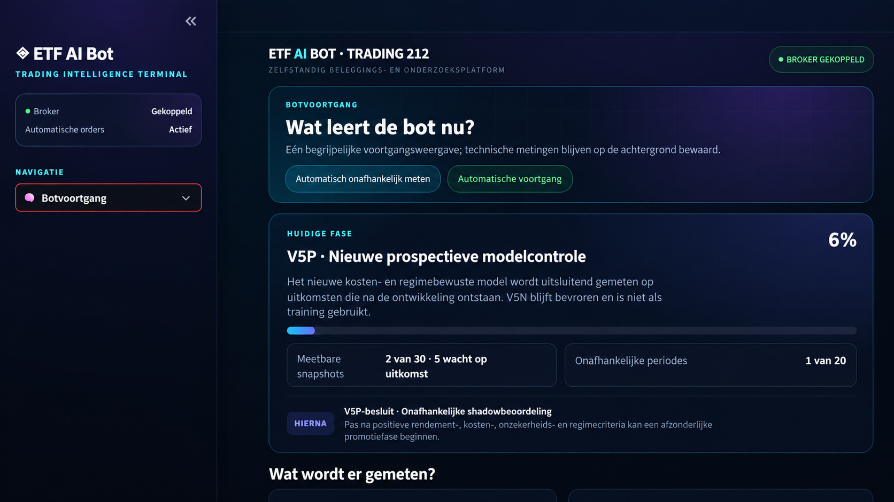
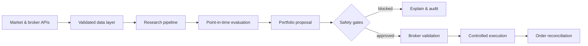
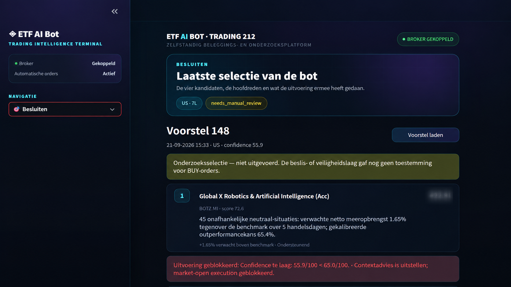
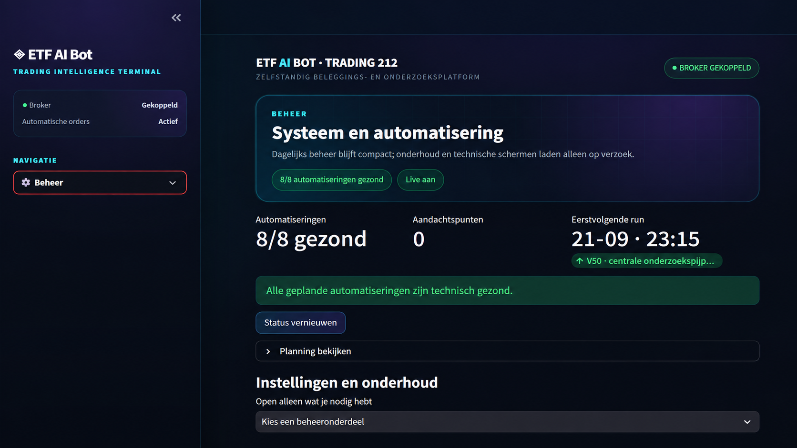
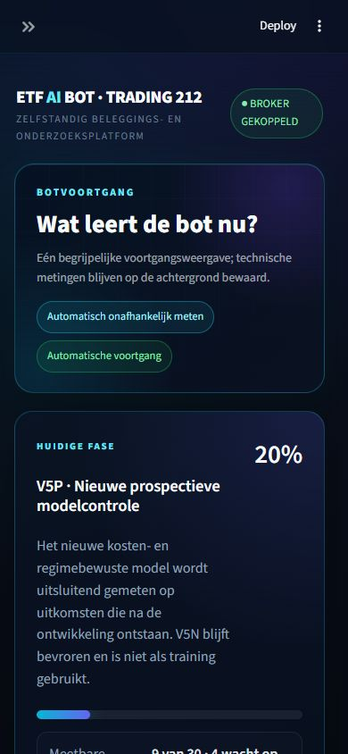

# ETF AI Bot — Trading Research & Automation Dashboard

## Project overview

This repository is a public case study of a privately operated Python platform for ETF research, portfolio proposals and controlled Trading 212 order execution. It demonstrates the product design, system architecture and safety engineering without publishing credentials, account data, proprietary models or production source code.

The platform was designed and developed by **Ellen Rensenbrink / SiteGuardly**.

## The challenge

Financial automation needs more than a scoring model. Market data can be incomplete, broker APIs can fail, research can accidentally use future information and a technically valid proposal can still be unsafe to execute.

The goal was therefore to build an understandable operator dashboard around a deliberately defensive pipeline:

- collect and validate market and broker data;
- separate research, shadow validation and execution;
- explain selections and rejection reasons;
- prevent duplicate or unintended orders;
- preserve audit evidence for every important decision;
- keep live execution behind explicit safety gates.

## Selected capabilities

- Trading 212 API integration with throttling, timeouts and bounded retries.
- ETF universe management, instrument validation and provider mapping.
- Multi-horizon research and walk-forward evaluation.
- Point-in-time data controls to reduce look-ahead and survivorship bias.
- Champion/challenger model evaluation and prospective shadow validation.
- Portfolio proposals with diversification, cost and turnover constraints.
- SELL-before-BUY validation and duplicate-order protection.
- Scheduled Windows automation with checkpoints and safe restart behaviour.
- Responsive Streamlit interface for desktop and mobile.
- SQLite persistence, migrations, audit records and automated tests.

## Architecture

The research pipeline cannot directly place orders. Execution is a separate boundary with its own checks, permissions and reconciliation. This separation makes the system easier to test and keeps experimental models away from live capital.

## Interface examples

### Controlled decision support

The dashboard explains why a candidate was selected and shows when execution is blocked by insufficient confidence or another safety rule.

### Automation health

Scheduled jobs, upcoming runs and technical health are presented in a compact operator view.

### Responsive operation

The operator interface remains readable on mobile without exposing the full technical workbench by default.

## Engineering focus

This project demonstrates experience with:

- Python application architecture;
- REST API integrations;
- financial data pipelines;
- defensive automation and idempotency;
- data quality and model governance;
- responsive dashboard design;
- background jobs and operational monitoring;
- SQLite schema evolution;
- unit, integration and safety testing.

## Privacy and availability

This is a **portfolio case study**. The production repository, live account connection, datasets, model artefacts and credentials are intentionally private. No investment recommendation or guarantee is provided.

